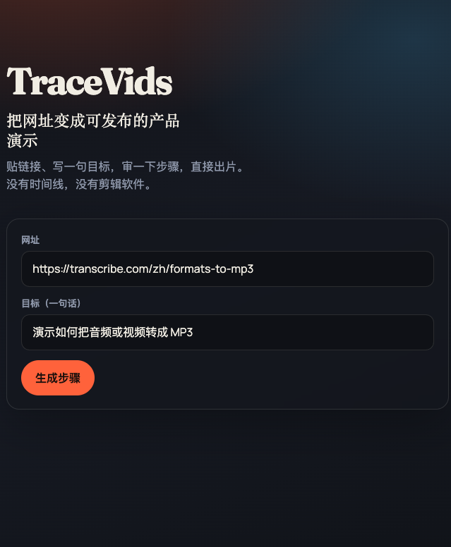
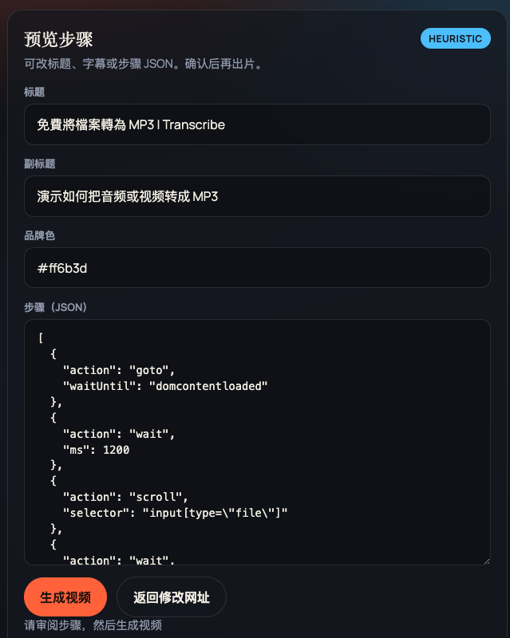
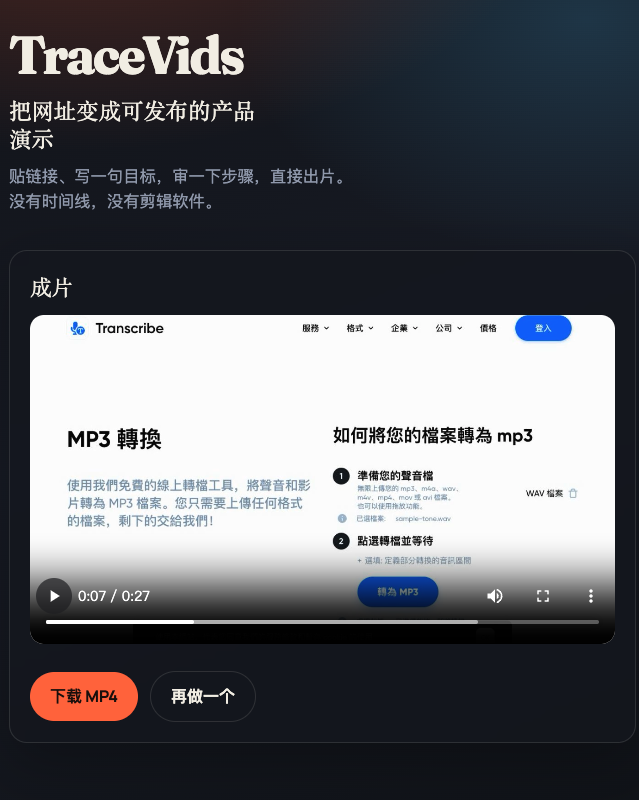

# TraceVids

**把网址变成可发布的产品演示视频。**

TraceVids 不是又一个剪辑软件。它把「打开网页 → 按步骤操作 → 录成素材 → 抛光出片」收成一条固定工作流：你给 URL（和一句目标），它产出带标题卡、镜头推进、点击高亮与字幕的演示片。

当前状态：**本地产品壳 + CLI 可用** — 贴链接 → 审步骤 → 出片下载。登录态 / 上云等仍在路线图中。

---

## 三步上手（界面演示）

截图在 [`docs/demo/`](docs/demo/)。打开产品壳后就是这条路径：

### 01 · 贴链接、写一句目标

填写网址与演示目标，点「生成步骤」。



### 02 · 审一下步骤

可改标题、副标题、品牌色和步骤 JSON，确认后再出片。



### 03 · 直接出片

预览成片，下载 MP4。没有时间线，没有剪辑软件。



本地启动：

```bash
cd workflow
npm run app
# → http://127.0.0.1:8787
```

---

## 产品是什么

| | |
|---|---|
| **输入** | 网址 + 目标句，或人手写的 YAML 分步脚本 |
| **过程** | Agent 生成可审脚本 → 本机 Chrome 自动操作并录像 → Remotion 套模板抛光 |
| **输出** | `demo.webm` + `demo-polished.mp4` + `meta.json`（步骤时间轴 / 字幕 / 品牌色） |

刻意不做：完整多轨剪辑器、系统级桌面录屏、交互式 click-through demo 托管。

---

## 核心思路

```text
URL + 目标说明
      ↓
  Agent 生成 YAML（LLM，无 Key 时启发式）
      ↓  人工可审 / 可改
  Playwright 浏览器录制（无需系统录屏权限）
      ↓
  Remotion 抛光（标题 / 推进 / 点击高亮 / 字幕 / 品牌色）
      ↓
  可发布 MP4
```

浏览器内录像，不依赖 macOS「屏幕录制」权限，也不用对齐系统窗口。

---

## 功能介绍

### 已具备

- **产品壳（本地 Web）** — `npm run app` → 贴 URL → 预览/改步骤 → 出片下载（无时间线）
- **Agent 生成脚本** — `npm run agent -- <url> --goal "..."`；有 `OPENAI_API_KEY` / `OPENROUTER_API_KEY` 走 LLM，否则启发式兜底
- **YAML 分步脚本** — `goto` / `click` / `type` / `scroll` / `upload` / `wait` / `hover` / `press` / `assert`
- **页面巡游录制** — Playwright `recordVideo`，优先本机 Google Chrome
- **多画幅** — `16:9`（1280×720）/ `9:16`（720×1280）/ `1:1`（1080×1080）；录制 viewport 与成片一致
- **旁白 TTS** — 主路径 **OpenAI Audio Speech（`tts-1`）**；无 Key 时 macOS 回退 **`say`（默认音色 Tingting）** → `voiceover.m4a`，Remotion 混入成片
- **Scout 扫页草稿** — 无 LLM 的启发式生成（轻量）
- **Remotion 抛光** — 标题卡、轻推进、点击高亮、步骤字幕、品牌色、旁白 → H.264 MP4
- **一条龙 CLI** — `npm run demo`：脚本或 URL+goal → 录制 → TTS → 抛光

### 规划中

- 多语言片头模板 / 更多 TTS 音色与语速控制
- 登录态、失败重试、CI 批量出片
- 云端部署与队列

---

## 适用场景

| 场景 | 怎么用 |
|---|---|
| **SaaS / 工具落地页演示** | `--goal "演示如何转 MP3"` 生成脚本后出片 |
| **文档 / Changelog 配视频** | 改 YAML 重跑 `demo`，无需重剪 |
| **销售 / 投放素材** | 固定抛光模板，直接嵌官网或信息流 |
| **竞品 / 页面走查存档** | Agent 出草稿 → 微调 → 录一版现状 |
| **批量内容** | 配好 API Key 后，可对 URL 列表循环 `demo --url --goal` |

示例脚本：

- 手写精修：[`workflow/scripts/formats-to-mp3.yaml`](workflow/scripts/formats-to-mp3.yaml)
- Agent 启发式产物示例：[`workflow/scripts/transcribe-agent.yaml`](workflow/scripts/transcribe-agent.yaml)

---

## 快速开始

### 环境要求

- Node.js **20+**
- 桌面环境 + **Google Chrome**
- 磁盘建议 **≥2GB**（Remotion / 浏览器缓存）
- （可选）OpenAI 或 OpenRouter API Key，用于更好的脚本生成

### 安装

```bash
cd workflow
npm install
npx playwright install ffmpeg
cd polish && npm install && cd ..
cp .env.example .env   # 可选：填入 OPENAI_API_KEY
```

### 最常用：打开产品壳

```bash
cd workflow
npm run app
# 浏览器打开 http://127.0.0.1:8787
```

流程：填写网址与目标 → **生成步骤** → 审阅/微调 → **生成视频** → 预览并下载 MP4。

### CLI（可选）

```bash
# 已有精修脚本 → 一条龙出片
npm run demo -- --script scripts/formats-to-mp3.yaml --out ./output/transcribe-mp3

# URL + 目标 → Agent 写脚本 → 录制 → 抛光
npm run demo -- --url https://transcribe.com/zh/formats-to-mp3 \
  --goal "演示如何把音频或视频转成 MP3" \
  --out ./output/transcribe-auto

# 只生成可审脚本（不录）
npm run agent -- https://example.com --goal "突出注册按钮和定价" -o scripts/example.agent.yaml
```

### 产出物

```text
output/transcribe-mp3/
  demo.webm            # 原始浏览器录像
  demo-polished.mp4    # 成片 ← 优先看这个
  meta.json            # 事件、字幕、品牌色
```

---

## 使用教程

### 教程 1：复现官方示例

```bash
cd workflow
npm run demo -- --script scripts/formats-to-mp3.yaml --out ./output/transcribe-mp3
open ./output/transcribe-mp3/demo-polished.mp4
```

成片含标题卡、蓝色品牌强调、步骤字幕与点击高亮。

### 教程 2：Agent 从零生成（推荐日常）

```bash
# 1) 生成并审阅
npm run agent -- https://你的产品.com/feature \
  --goal "20 秒演示核心转化路径" \
  -o scripts/my-feature.yaml

# 2) 打开 YAML，改掉不准的 selector / 删掉多余点击

# 3) 出片
npm run demo -- --script scripts/my-feature.yaml --out ./output/my-feature
```

或一步到位（生成后立刻录，适合草稿验证）：

```bash
npm run demo -- --url https://你的产品.com/feature \
  --goal "20 秒演示核心转化路径" \
  --out ./output/my-feature
```

### 教程 3：调试选择器

```bash
npm run record -- --script scripts/my-feature.yaml --out ./output/debug --headed
```

`--headed` 会显示浏览器窗口，便于看清点没点到。

### 配置 LLM（可选但推荐）

编辑 `workflow/.env`：

```bash
OPENAI_API_KEY=sk-...
# 或
OPENROUTER_API_KEY=sk-or-...
TRACEVIDS_MODEL=openai/gpt-4o-mini
```

无 Key 时 Agent 自动走启发式（能跑，质量一般，务必人工审脚本）。

---

## 步骤脚本说明

```yaml
name: my-demo
url: https://example.com
title: 产品一句话标题
subtitle: 副标题 / 目标句
aspectRatio: "16:9"   # 或 9:16 / 1:1
voiceover: true       # 旁白 TTS
# narration: "可选：完整旁白文案；默认用 title + subtitle + captions"
brandColor: "#2f6fed"
captions:
  - atStep: 0
    text: 开场说明
  - atStep: 4
    text: 点击主按钮
steps:
  - action: goto
    waitUntil: domcontentloaded
  - action: wait
    ms: 1000
  - action: click
    selector: "text=立即开始"
```

### 旁白 TTS 说明

| 优先级 | 引擎 | 条件 |
|---|---|---|
| 1 | **OpenAI `tts-1`** | `OPENAI_API_KEY`（或兼容网关） |
| 2 | **macOS `say`** | 无 Key 且运行在 macOS；默认中文音色 `Tingting` |

环境变量见 [`workflow/.env.example`](workflow/.env.example)：`TRACEVIDS_TTS_VOICE`（如 `nova`）、`TRACEVIDS_SAY_VOICE`。

旁白文案默认拼接 `title` + `subtitle` + `captions`；也可用 `narration` 覆盖全文。

### 支持的 action

| action | 作用 | 常用字段 |
|---|---|---|
| `goto` | 打开页面 | `url?` `waitUntil?` |
| `wait` | 等待时间或元素 | `ms?` `selector?` `state?` |
| `click` | 点击 | `selector` |
| `hover` | 悬停（可出高亮） | `selector` |
| `type` | 输入 | `selector` `text` |
| `press` | 按键 | `key` |
| `scroll` | 滚动 | `y?` `selector?` |
| `upload` | 上传文件 | `path` `selector?` |
| `assert` | 断言 | `selector` `textContains?` |

选择器使用 [Playwright selectors](https://playwright.dev/docs/selectors)：`text=...`、`css=...`、`role=button[name=/.../i]`。

---

## 仓库结构

```text
TraceVids/
  README.md
  docs/demo/              # 三步界面演示截图（README 用）
  workflow/
    .env.example
    scripts/              # YAML 脚本
    fixtures/             # 上传样例
    web/                  # 产品壳前端
    src/
      server.ts           # 本地 Web + API
      pipeline.ts         # 生成 / 录制 / 抛光编排
      agent.ts            # URL+goal → YAML
      scout.ts            # 无 LLM 扫页
      recordUrl.ts        # 录制 CLI
      demo.ts             # 一条龙 CLI
      script/             # 加载 / 执行 / 生成
    polish/               # Remotion 抛光
    output/               # 本地产出（gitignore）
```

---

## 常见问题

**Q: 和 Loom / Screen Studio / OpenScreen 有什么区别？**  
A: 那些偏「人录屏 + 编辑器」。TraceVids 偏「脚本驱动浏览器 + 固定模板出片」，目标是可重复、可批量。

**Q: Agent 没有 API Key 能用吗？**  
A: 能。会走启发式并根据 goal 关键词匹配按钮/上传控件。务必打开 YAML 审一遍再录。

**Q: LLM 和启发式差在哪？**  
A: LLM 能按「目标句」组织叙事、写字幕与更稳的步骤顺序；启发式更像「看见啥点啥」。

**Q: 提示找不到 ffmpeg？**  
A: `cd workflow && npx playwright install ffmpeg`。

**Q: Remotion 首次很慢？**  
A: 会下载 Headless Shell，属正常；有缓存后会快很多。

**Q: 成片没有字幕？**  
A: 在 YAML 里加 `captions`（`atStep` + `text`），或让 Agent 生成（启发式/LLM 都会带 captions）。

**Q: 如何改品牌色？**  
A: YAML 顶层 `brandColor: "#RRGGBB"`，影响标题装饰条、点击环、字幕底边。

**Q: 用的哪家 TTS？**  
A: 有 OpenAI Key 时用 **OpenAI `tts-1`**；否则在 macOS 上用系统 **`say`**（默认 `Tingting`）。成片混入 `voiceover.mp3` / `.m4a`。

**Q: 怎么出竖屏 / 方形？**  
A: 设 `aspectRatio: "9:16"` 或 `"1:1"`（产品壳里也可选）。录制与抛光画幅一致。

**Q: 登录后的页面？**  
A: MVP 未内置登录态；公开页或可匿名演示的路径最稳。登录态在路线图中。

**Q: Remotion 许可？**  
A: 见 [remotion.dev/docs/license](https://www.remotion.dev/docs/license)；公司使用前请自行确认。

---

## 路线图

| 状态 | 项 |
|---|---|
| Done | LLM / 启发式生成 YAML |
| Done | 抛光：字幕 + 品牌色 |
| Done | 产品壳（贴 URL → 预览步骤 → 下载） |
| Done | 旁白 TTS（OpenAI + macOS say）、多画幅 |
| Next | 登录态、重试、CI 批量 / 上云 |
| Later | 更多 TTS 引擎与片头模板 |

---

## 许可与致谢

- 录制：[Playwright](https://playwright.dev/)
- 抛光：[Remotion](https://www.remotion.dev/)
- 生成：[Vercel AI SDK](https://sdk.vercel.ai/)（可选）
